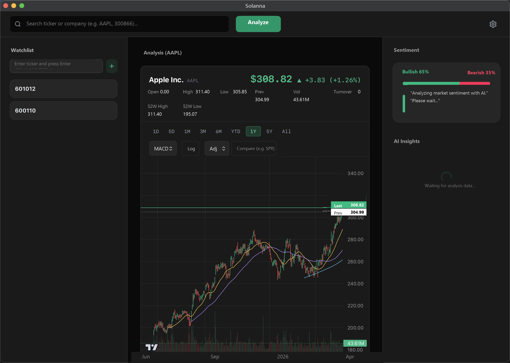

<p align="center">
  
</p>

<h1 align="center">Solanna</h1>

<p align="center">
  <strong>An AI equity research desk that runs entirely on your machine.</strong>
</p>

<p align="center">
  <a href="https://github.com/truongdatdev/solanna/releases/latest"></a>
  <a href="https://github.com/truongdatdev/solanna/releases"></a>
  <a href="https://github.com/truongdatdev/solanna/stargazers"></a>
  <a href="./LICENSE"></a>
  
</p>



## Overview

Solanna is a local-first desktop application for equity research. It brings live news, prices, fundamentals, money flow and quantitative signals together in one workspace, then layers AI analysis on top. Everything runs on your machine: there is no hosted backend, and your API keys never leave your device.

Built with **Tauri 2**, **React 19** and a compiled **Bun** sidecar, Solanna is designed for investors who want fast, explainable research without giving up control of their data.

## Highlights

### AI-powered research

- **Sentiment analysis:** scans recent news for a ticker and returns a bullish/bearish breakdown with source-linked factor cards.
- **Investor-master analysis:** runs up to 13 investor-master agents, each reasoning through its own framework, then synthesises their views into a consensus rating.
- **Grounded chat:** answers questions using earnings reports, recent news and the quantitative metrics already loaded in the app, with citations back to the source.
- **Bring your own model:** supports OpenAI, Anthropic, DeepSeek, GLM and local Ollama models. Models can be assigned per role.

### Quantitative analysis

- **Composite quant score:** combines technical, fundamental and valuation signals, with volatility-aware adjustment.
- **Natural-language screener:** translates plain-English criteria into a market-wide scan and shows how the query was interpreted before running it.
- **Strategy backtesting:** reports total return, annualised return, trade count, buy-and-hold comparison, entries/exits and an equity curve.
- **Master track record:** records directional calls locally and marks them to market so hit rates and an equal-weight NAV curve accumulate over time.

### Market data and charts

- **Interactive K-line charts:** MA/BOLL overlays, nine time ranges, MACD/RSI/KDJ/OBV/VWAP sub-charts, logarithmic scale, adjusted prices and benchmark comparison.
- **Market overview:** major index bar, sector and concept leaderboards, fund-flow rankings and the Dragon-Tiger list for A-shares.
- **Company profile (F10):** business overview, revenue breakdown, shareholder structure and sector tags, loaded on demand.
- **Redundant data sources:** quotes, candles, fundamentals and market data fall back across Tencent, Eastmoney, Sina and Yahoo.

### Portfolio and workflow

- **Portfolio tracking:** positions, live valuation, unrealised and daily P&L, and position weights, with currencies kept separate.
- **Watchlist and price alerts:** quick-add symbols and receive system notifications when price thresholds are crossed.
- **Local analysis history:** every analysis, deep analysis and screen is archived in SQLite and can be reopened in full.

## Installation

Pre-built binaries are available on the [Releases](https://github.com/truongdatdev/solanna/releases/latest) page.

### macOS

If macOS reports that the app is damaged, clear the quarantine attribute:

```bash
xattr -cr /Applications/Solanna.app
```

### Linux

```bash
sudo dpkg -i Solanna_*_amd64.deb
```

WebKitGTK is required and is pre-installed on most GNOME-based distributions.

### Windows

Windows SmartScreen may warn about unsigned executables. Choose **More info**, then **Run anyway**.

## Getting started

### Prerequisites

- [Bun](https://bun.sh/): package manager and sidecar runtime
- [Rust](https://www.rust-lang.org/tools/install): Tauri core
- Platform dependencies required by [Tauri 2](https://v2.tauri.app/start/prerequisites/)

### Install and run

```bash
git clone https://github.com/truongdatdev/solanna.git
cd solanna
bun install
bun tauri dev
```

The development command compiles the sidecar binary for your platform before starting the app.

### Build a release

```bash
bun tauri build
```

To compile the sidecar for a specific target:

```bash
BUN_TARGET=bun-windows-x64 bun sidecar/build-script.ts
```

Supported targets: `bun-darwin-arm64`, `bun-darwin-x64`, `bun-linux-x64` and `bun-windows-x64`. Output is written to `src-tauri/bin/` using the Rust target triple expected by Tauri.

## Architecture

Solanna uses a strictly unidirectional three-layer architecture:

```text
React UI  ->  Tauri Core (Rust)  ->  Sidecar (Bun)
```

- **Frontend (`src/`):** React, TypeScript and Vite. All IPC goes through a single entry point; local history is stored in SQLite via `tauri-plugin-sql`.
- **Tauri Core (`src-tauri/`):** exposes one generic `invoke_sidecar` command, handles process lifecycle and keeps business logic out of Rust.
- **Sidecar (`sidecar/`):** a compiled Bun binary that scrapes news, computes quantitative metrics and communicates with AI providers.

The `shared/` directory is the single source of truth for DTOs, CLI actions, provider profiles and market detection across all three layers.

## Configuration

Open **Settings** in the app, choose an AI provider and enter your API key. Configuration and keys are stored locally through `tauri-plugin-store`.

Solanna does not proxy requests or host any models. Analysis requests go directly from your machine to the provider you configure.

## Project structure

```text
.
├── src/                 React frontend
├── src-tauri/           Tauri core, capabilities and migrations
├── sidecar/             Bun sidecar, data sources and AI providers
├── shared/              Cross-layer types and constants
├── scripts/             Build, verification and smoke-test tooling
└── docs/                Design notes, release notes and screenshots
```

## Testing

```bash
bun run test               # offline unit tests: Vitest + sidecar Bun tests
bun run test:integration   # adds live-network data-source checks
bun run test:e2e           # browser smoke test for chart rendering
bun run format             # Biome formatter
cd src-tauri && cargo test # Rust core tests
```

The default test suite is fully offline. Network-dependent checks live in `*.integration.ts` files and run separately through the integration and scheduled data-source workflows.

## Tech stack

- **Desktop:** Tauri 2, Rust, SQLite via `tauri-plugin-sql`, signed auto-updates
- **Frontend:** React 19, TypeScript, Tailwind CSS 4, Lightweight Charts, Lucide
- **Sidecar:** Bun, Playwright, node-html-markdown
- **AI:** OpenAI SDK, Anthropic SDK and Ollama, with OpenAI-compatible endpoints for DeepSeek and GLM
- **Tooling:** Biome, Vitest, Lefthook

## Contributing

Contributions are welcome. Please read the [Contributing Guide](./CONTRIBUTING.md) and [Code of Conduct](./CODE_OF_CONDUCT.md) before opening a pull request.

- Bug reports: [Issues](https://github.com/truongdatdev/solanna/issues)
- Feature requests and questions: [Discussions](https://github.com/truongdatdev/solanna/discussions)

## Security

Please report vulnerabilities privately through [GitHub Security Advisories](https://github.com/truongdatdev/solanna/security/advisories/new). See [SECURITY.md](./SECURITY.md) for details.

## License

[MIT](./LICENSE) © 2026 truongdatdev

## Disclaimer

Solanna is a research and educational tool. Its output, including AI-generated ratings, master consensus, quantitative scores and backtest results, is not investment advice. Market data comes from public third-party sources and may be delayed, incomplete or incorrect. You are solely responsible for your investment decisions.

